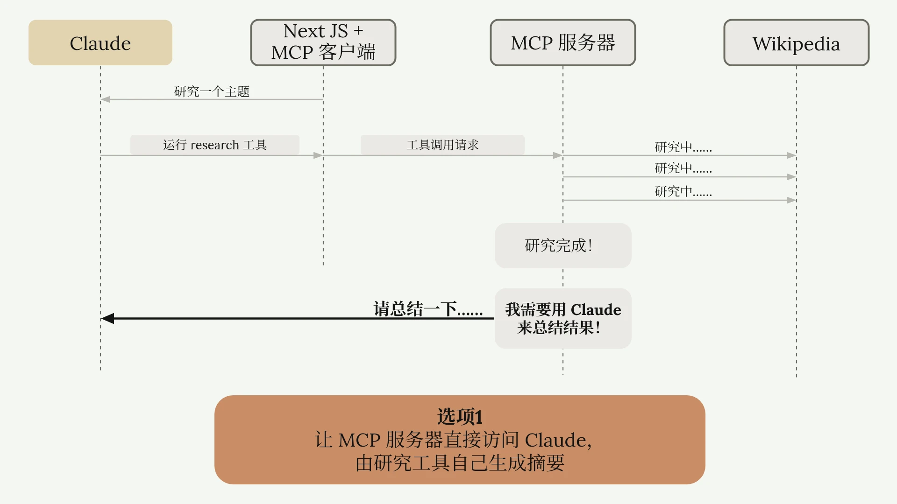
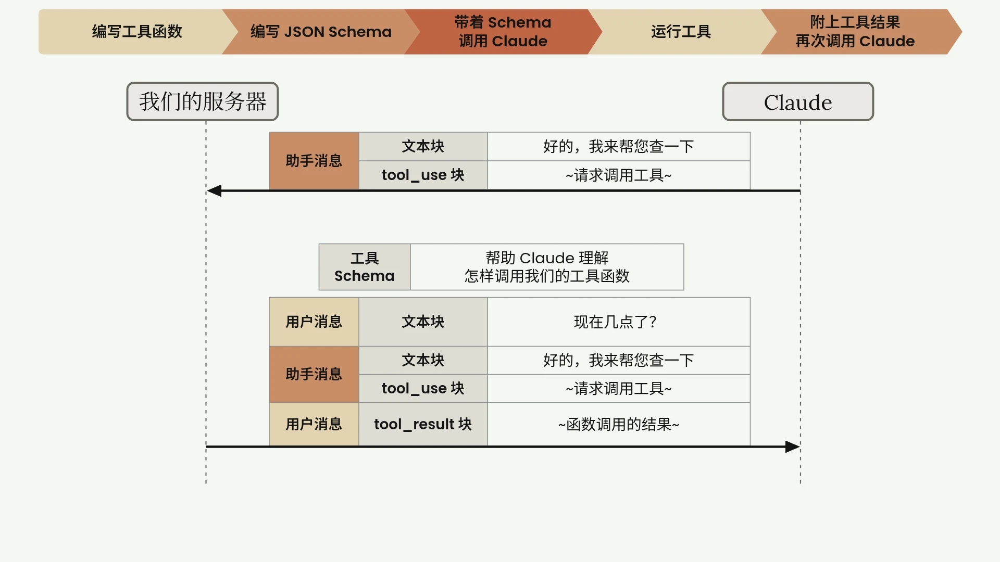

<div align="center">

**简体中文** · [English](./README.en.md)

# Littlebear Skills

**我自己写、自己天天在用的 Agent Skills。**

画课件风配图、在终端里讲清一段代码、分析 BOSS 直聘上的岗位、汇总世界杯各模型的预测。<br/>
每个技能一个文件夹，一条命令装进 Claude Code、Cursor、Codex 等支持 Agent Skills 的工具。

[](./LICENSE)

[](https://agentskills.io)
[](https://huangsitao.fun/skills)

[技能一览](#技能一览) · [安装](#安装) · [技能详解](#技能详解) · [仓库结构](#仓库结构) · [反馈](#反馈与贡献)

<code>npx skills add litterbear520/littlebear-skills</code>

</div>

---

Skills 是“指令 + 脚本 + 资源”组成的文件夹。Agent 按 `SKILL.md` 里写明的时机自动加载它，把某一类任务用可复现的方式做好。这个仓库里的技能都遵循 [Agent Skills](https://agentskills.io) 开放标准，同一份 `SKILL.md` 在不同工具里都能用。

这些技能都来自我自己的日常工作：写博客要配图、读代码要讲清楚、找工作要看行情、看球要汇总预测。每一个都在真实任务里反复用过、按出过的问题改过。它们有一个共同的做法：**判断交给模型，计数、渲染、校验交给脚本**，所以同样的输入能得到同样的产物，也省 token。

## 技能一览

| 技能 | 做什么 | 怎么用 | 依赖 |
| ---- | ---- | ---- | ---- |
| [academy-diagram-design](#academy-diagram-design) | 画幻灯片式的课件配图，出 SVG 源文件和 WebP，自带渲染检查 | 说“用 academy 图表设计画一张……” | Node 22+、Chrome |
| [explain](#explain) | 在终端里把一个概念或一段代码讲成一篇课文 | 手动输入 `/explain <问题>` | 无 |
| [boss-job-analyzer](#boss-job-analyzer) | 抓 BOSS 直聘某类岗位的真实 JD，出技术栈、学历薪资分布和岗位卡片墙报告 | 说“看看 BOSS 上 AI Agent 岗位都要什么” | Python 3、[web-access](https://github.com/eze-is/web-access) |
| [worldcup-bet-advisor](#worldcup-bet-advisor) | 汇总多个 AI 模型对世界杯比赛的下注和比分，叠加全玩法实时倍率，出单文件报告 | 说“今天这几场世界杯各模型怎么预测” | Python 3、[web-access](https://github.com/eze-is/web-access) |

## 安装

### 方式一：`npx skills`（推荐，跨工具）

[`npx skills`](https://github.com/vercel-labs/skills) 是开放的 Agent Skills 安装器，支持 Claude Code、Cursor、Codex、OpenCode 等 70 多种 agent。不带参数时会列出本仓库的技能让您勾选：

```bash
npx skills add litterbear520/littlebear-skills
```

只装其中一个，用 `--skill` 指定名字：

```bash
npx skills add litterbear520/littlebear-skills --skill explain
```

以后更新：`npx skills update`。

### 方式二：Claude Code 插件

在 Claude Code 里把本仓库加成插件市场，再安装插件，四个技能一次装齐，之后跟着仓库自动更新：

```text
/plugin marketplace add litterbear520/littlebear-skills
/plugin install littlebear-skills@littlebear
```

插件里的技能带插件名前缀，比如 `/littlebear-skills:explain`。两种方式选一种就好，都装会让每个技能出现两次。

### 方式三：手动复制

```bash
git clone https://github.com/litterbear520/littlebear-skills.git
cp -r littlebear-skills/skills/explain ~/.claude/skills/      # 换成您要的技能和对应工具的 skills 目录
```

## 技能详解

### academy-diagram-design

<table>
<tr>
<td></td>
<td></td>
</tr>
</table>

画幻灯片式的课件配图：Lora 衬线字、米黄和陶土色块、粗黑箭头、压在箭头上的消息标签、消息表、底部结论条。上面两张图都是用它画的。

- **一张图一件事**：2–6 个主元素，大字号、大留白，缩到正文宽度后框名和正文差不多大。
- **样式写在一个地方**：SVG 里只写 `assets/academy.css` 的类名和坐标，颜色、字体、字号由渲染脚本注入，换图不会跑样。
- **渲染即检查**：`scripts/render.mjs` 用无头 Chrome 渲染，先查字体、出画布、文字重叠、字号和调色板，再导出 WebP，并给出 PNG 预览让模型自己看一遍。
- **能一比一复刻**：给一张现成的英文原图，它会量出颜色、字号和坐标照着重画，用差值图核对，再换成中文。

**依赖**：Node 22 以上、Chrome（找不到时设环境变量 `CHROME`）。中文默认用本机的 Noto Serif SC / Noto Sans SC；项目自托管了这两种字体时，把 `CJK_FONTS_CSS` 设成那份 `@font-face` CSS 的路径。

**了解更多**：[SKILL.md](./skills/academy-diagram-design/SKILL.md) · [构件尺寸](./skills/academy-diagram-design/references/components.md) · [复刻流程](./skills/academy-diagram-design/references/replicate.md)

### explain

把您的问题讲成一篇课文：先讲它解决什么问题，再讲工作原理、实现、取舍和适用场合。整篇就是终端里的一条回复，图也用 Unicode 制表符画成文本图。

```text
/explain 为什么这个项目的工具执行函数从不抛异常
```

- **按问题选讲法**：“是什么 / 怎么工作 / 为什么这样设计 / 该选哪个 / 为什么会这样”五类问题各有一套骨架。
- **只讲读过的代码**：每段代码都来自这次读过的文件，并标出 `文件:行号`；每个“什么时候触发”的说法都能指到一行代码。
- **只讲不改**：这个技能不新建、不修改任何文件。它只在您手动输入 `/explain` 时运行，不会被模型自动调用。

**了解更多**：[SKILL.md](./skills/explain/SKILL.md)

### boss-job-analyzer

> 别再一条条手翻 JD，让模型替您读完几十条招聘，告诉您这一行到底要什么、该补什么。

把“看看 BOSS 上某类岗位都要什么”变成一份岗位数据加一份单文件 HTML 报告：

- **抓取**：通过 web-access 的 CDP 复用您日常 Chrome 的登录态，抓某类岗位的真实 JD（薪资、公司、经验学历、技能标签、职责要求原文）。
- **分工**：模型逐个岗位标注技术栈、语言和职责，不靠写死的词典；脚本确定性地算占比、共现和薪资分布，再检查标注有没有漏标、同义词有没有写成两种。
- **报告**：概览数字和求职建议、4 个分析维度，还有可点开看 BOSS 原文的岗位卡片墙（支持搜索、按经验学历筛选、按薪资排序），单文件，离线也能看。

**依赖**：Python 3（只用标准库）+ [web-access](https://github.com/eze-is/web-access)。BOSS 反爬严格，抓取必须走它的 CDP，这是硬依赖；没装时技能会先问您要不要装。

**了解更多**：[SKILL.md](./skills/boss-job-analyzer/SKILL.md) · [站点笔记](./skills/boss-job-analyzer/references/zhipin-site-notes.md)

> 复用的是您自己的合法登录态，像人一样浏览。请遵守站点条款，控制抓取频率。

### worldcup-bet-advisor

把多个 AI 模型（Claude、DeepSeek、GPT、Gemini、GLM、Kimi 等）对每场比赛的下注、最可能比分和原话，连同当天全玩法（胜平负、让球、比分、总进球、半全场）的实时倍率和去水概率，汇总成一份单文件 HTML 报告。

- **只呈现，不推荐**：报告原样汇总各模型说了什么、市场怎么看，不加自己的判断和买法。
- **模型只做一件事**：比分归一是全流程里唯一要模型判断的一步，抓取、合并、去水、渲染都由脚本完成。
- **每日站点**：可选把报告发布到 Vercel，带日期切换和收益仪表盘。作者 2026 世界杯赛期每天的报告在 **<https://worldcup-bet-site.vercel.app>**。

**依赖**：Python 3（只用标准库）+ [web-access](https://github.com/eze-is/web-access)（打开报告；接口被反爬挡住时兜底抓数据）。发布站点另需 Node、pnpm 和 Vercel 账号，见 [site-deploy.md](./skills/worldcup-bet-advisor/references/site-deploy.md)。

**了解更多**：[SKILL.md](./skills/worldcup-bet-advisor/SKILL.md) · [数据来源](./skills/worldcup-bet-advisor/references/data-sources.md)

> 报告只是信息汇总，不构成投注建议。理性娱乐，量力而行。

## 仓库结构

```text
littlebear-skills/
├── .claude-plugin/
│   └── marketplace.json        # Claude Code 插件市场清单，插件会加载 skills/ 下的全部技能
├── skills/
│   ├── academy-diagram-design/ # SKILL.md + assets/ references/ scripts/ examples/
│   ├── explain/
│   ├── boss-job-analyzer/
│   └── worldcup-bet-advisor/   # 另含 web/：每日报告站点（Next.js）
└── docs/assets/                # README 用图
```

每个技能都是一个自包含的文件夹：`SKILL.md` 开头的 YAML 写 `name` 和 `description`，正文写步骤；脚本和参考资料放在同一个文件夹里，用相对路径引用，装到哪里都能用。

## 反馈与贡献

欢迎在 [Issues](https://github.com/litterbear520/littlebear-skills/issues) 报 bug、提建议、求新技能。想加技能或改技能，先看 [CONTRIBUTING.md](./CONTRIBUTING.md)。

这些技能也收录在我博客的 [SkillHub](https://huangsitao.fun/skills)，那里还有我常用的其他技能。

## 许可

代码和文档采用 [MIT](./LICENSE) 许可。`academy-diagram-design` 自带的 Lora、Poppins、Roboto Mono 字体采用 SIL Open Font License，许可文本在 [`assets/fonts/`](./skills/academy-diagram-design/assets/fonts/)。
